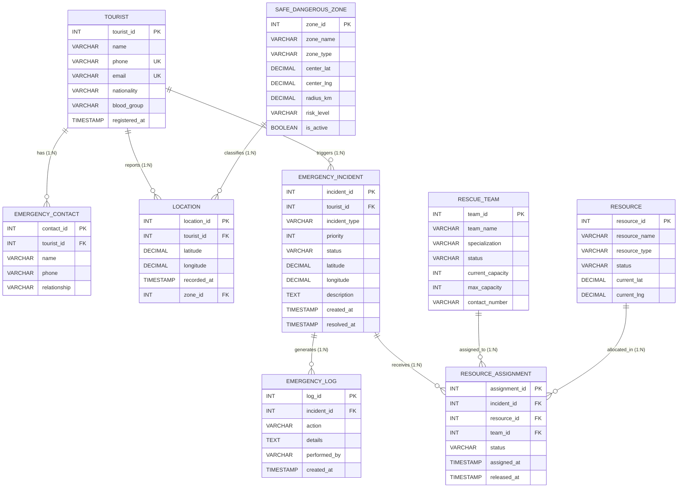

# Database Design & Architecture Specification
## Smart Tourist Safety and Emergency Response System

---

## 1. Executive Summary & Purpose

The **Smart Tourist Safety and Emergency Response System** requires a high-performance relational database capable of handling concurrent, safety-critical events while maintaining strict **ACID** (Atomicity, Consistency, Isolation, Durability) guarantees. 

This document formalizes:
1. **Entity-Relationship (ER) Modeling**: Conceptual schema with cardinalities.
2. **Data Dictionary**: Comprehensive column definitions, constraints, data types, and default values across 9 relational tables.
3. **Normalization Analysis**: Mathematical verification of 1NF, 2NF, and 3NF across all entities.
4. **Referential Integrity & Cascading Rules**: Explicit foreign key actions (`ON DELETE`, `ON UPDATE`) preventing orphan records.
5. **Domain Integrity & Constraints**: Primary Keys, Unique constraints, Not Null guarantees, and CHECK constraints.
6. **Indexing Strategy**: B-Tree and compound indexes optimized for high-frequency queries and joins.
7. **Concurrency Control & Transaction Boundaries**: Concurrency guarantees, row-level locking (`FOR UPDATE`), advisory locks, and deadlock avoidance alignment.

---

## 2. Entity-Relationship (ER) Diagram



---

## 3. Relational Schema & Data Dictionary

### Table 1: `tourists`
Maintains profile and identification data for tourists registering through the mobile application.

| Column | Type | Nullable | Key / Constraint | Description |
|---|---|---|---|---|
| `tourist_id` | `SERIAL` | **NO** | `PRIMARY KEY` | Unique auto-incrementing identifier |
| `name` | `VARCHAR(100)` | **NO** | — | Full name of the tourist |
| `phone` | `VARCHAR(20)` | **NO** | `UNIQUE` | Contact number used as primary phone credential |
| `email` | `VARCHAR(120)` | **NO** | `UNIQUE` | Contact email address |
| `nationality` | `VARCHAR(50)` | YES | — | Tourist citizenship (for embassy alerts) |
| `blood_group` | `VARCHAR(10)` | YES | — | Medical blood group (e.g., O+, A-, AB+) |
| `registered_at`| `TIMESTAMPTZ` | **NO** | `DEFAULT NOW()` | Timestamp of initial account creation |

---

### Table 2: `emergency_contacts`
Secondary points of contact (family, guardians, local embassy) associated with a tourist.

| Column | Type | Nullable | Key / Constraint | Description |
|---|---|---|---|---|
| `contact_id` | `SERIAL` | **NO** | `PRIMARY KEY` | Unique contact record ID |
| `tourist_id` | `INT` | **NO** | `FK -> tourists(tourist_id) ON DELETE CASCADE` | Associated tourist |
| `name` | `VARCHAR(100)` | **NO** | — | Name of emergency contact |
| `phone` | `VARCHAR(20)` | **NO** | — | Contact telephone number |
| `relationship`| `VARCHAR(50)` | **NO** | — | Relationship to tourist (e.g. Parent, Spouse) |

---

### Table 3: `safe_dangerous_zones`
Geographic boundaries representing safe tourist hubs or hazardous geo-restricted areas.

| Column | Type | Nullable | Key / Constraint | Description |
|---|---|---|---|---|
| `zone_id` | `SERIAL` | **NO** | `PRIMARY KEY` | Unique zone identifier |
| `zone_name` | `VARCHAR(100)` | **NO** | — | Human-readable name of the zone |
| `zone_type` | `VARCHAR(20)` | **NO** | `CHECK (zone_type IN ('SAFE', 'DANGEROUS'))` | Classification of zone |
| `center_lat` | `DECIMAL(9, 6)`| **NO** | — | Latitude coordinate of geofence centroid |
| `center_lng` | `DECIMAL(9, 6)`| **NO** | — | Longitude coordinate of geofence centroid |
| `radius_km` | `DECIMAL(6, 2)`| **NO** | `CHECK (radius_km > 0)` | Radius in kilometers from centroid |
| `risk_level` | `VARCHAR(20)` | **NO** | `CHECK (risk_level IN ('LOW', 'MEDIUM', 'HIGH', 'CRITICAL'))` | Danger severity rating |
| `is_active` | `BOOLEAN` | **NO** | `DEFAULT TRUE` | Whether geofence rule is actively evaluated |

---

### Table 4: `locations`
Time-series GPS coordinates recorded from tourists for history and proximity analysis.

| Column | Type | Nullable | Key / Constraint | Description |
|---|---|---|---|---|
| `location_id` | `SERIAL` | **NO** | `PRIMARY KEY` | Unique GPS fix record ID |
| `tourist_id` | `INT` | **NO** | `FK -> tourists(tourist_id) ON DELETE CASCADE` | Reporting tourist |
| `latitude` | `DECIMAL(9, 6)`| **NO** | — | Recorded latitude coordinate |
| `longitude` | `DECIMAL(9, 6)`| **NO** | — | Recorded longitude coordinate |
| `recorded_at`| `TIMESTAMPTZ` | **NO** | `DEFAULT NOW()` | Exact timestamp of coordinate recording |
| `zone_id` | `INT` | YES | `FK -> safe_dangerous_zones(zone_id) ON DELETE SET NULL` | Zone match if located inside boundary |

---

### Table 5: `emergency_incidents`
Central table managing the lifecycle of emergency distress calls and detected danger events.

| Column | Type | Nullable | Key / Constraint | Description |
|---|---|---|---|---|
| `incident_id` | `SERIAL` | **NO** | `PRIMARY KEY` | Unique emergency incident identifier |
| `tourist_id` | `INT` | **NO** | `FK -> tourists(tourist_id) ON DELETE RESTRICT` | Tourist who triggered or is involved in incident |
| `incident_type`| `VARCHAR(50)`| **NO** | `CHECK (incident_type IN ('CRITICAL_ACCIDENT', 'SOS', 'DANGEROUS_ZONE', 'SAFETY_ALERT', 'GPS_UPDATE'))` | Nature of emergency event |
| `priority` | `INT` | **NO** | `CHECK (priority BETWEEN 1 AND 5)` | Priority: 1=Critical, 2=SOS, 3=Zone, 4=Alert, 5=GPS |
| `status` | `VARCHAR(30)` | **NO** | `CHECK (status IN ('RECEIVED', 'QUEUED', 'PROCESSING', 'RESOURCE_ASSIGNED', 'RESOLVED', 'FAILED'))` | Incident lifecycle state |
| `latitude` | `DECIMAL(9, 6)`| **NO** | — | Latitude coordinate of distress site |
| `longitude` | `DECIMAL(9, 6)`| **NO** | — | Longitude coordinate of distress site |
| `description` | `TEXT` | YES | — | Narrative description or sensor notes |
| `created_at` | `TIMESTAMPTZ` | **NO** | `DEFAULT NOW()` | Time incident was received by backend |
| `resolved_at`| `TIMESTAMPTZ` | YES | — | Time incident was resolved / marked completed |

---

### Table 6: `emergency_logs`
Immutable audit log recording every system action taken on an incident (worker thread steps, Banker's checks, DB commits/rollbacks).

| Column | Type | Nullable | Key / Constraint | Description |
|---|---|---|---|---|
| `log_id` | `SERIAL` | **NO** | `PRIMARY KEY` | Unique log entry ID |
| `incident_id` | `INT` | **NO** | `FK -> emergency_incidents(incident_id) ON DELETE CASCADE` | Associated incident |
| `action` | `VARCHAR(50)` | **NO** | — | Action tag (e.g. `BANKER_CHECK_SAFE`, `TX_COMMITTED`) |
| `details` | `TEXT` | YES | — | Structured details or parameters of action |
| `performed_by`| `VARCHAR(50)`| **NO** | — | Subsystem actor (e.g. `WORKER_THREAD_1`, `RESOURCE_MGR`) |
| `created_at` | `TIMESTAMPTZ` | **NO** | `DEFAULT NOW()` | Timestamp of logged event |

---

### Table 7: `rescue_teams`
Emergency response personnel groups (paramedics, search teams, fire squads).

| Column | Type | Nullable | Key / Constraint | Description |
|---|---|---|---|---|
| `team_id` | `SERIAL` | **NO** | `PRIMARY KEY` | Unique rescue team identifier |
| `team_name` | `VARCHAR(100)`| **NO** | — | Official team designation |
| `specialization`|`VARCHAR(50)`| **NO** | `CHECK (specialization IN ('MEDICAL', 'SEARCH_AND_RESCUE', 'FIRE', 'GENERAL'))` | Field capability |
| `status` | `VARCHAR(30)` | **NO** | `CHECK (status IN ('AVAILABLE', 'BUSY', 'OFF_DUTY'))` | Operational readiness |
| `current_capacity`| `INT` | **NO** | `DEFAULT 0 CHECK (current_capacity >= 0)` | Currently assigned units/members |
| `max_capacity`| `INT` | **NO** | `CHECK (max_capacity > 0 AND max_capacity >= current_capacity)` | Maximum available operational capacity |
| `contact_number`|`VARCHAR(20)`| **NO** | — | Team dispatch contact number |

---

### Table 8: `resources`
Physical units and equipment available for dispatch (ambulances, helicopters, rescue boats).

| Column | Type | Nullable | Key / Constraint | Description |
|---|---|---|---|---|
| `resource_id` | `SERIAL` | **NO** | `PRIMARY KEY` | Unique physical resource identifier |
| `resource_name`| `VARCHAR(100)`| **NO** | — | Identifier label (e.g., `Ambulance-01`, `Helicopter-02`) |
| `resource_type`| `VARCHAR(50)` | **NO** | `CHECK (resource_type IN ('AMBULANCE', 'HELICOPTER', 'FIRE_TRUCK', 'RESCUE_BOAT'))` | Equipment classification |
| `status` | `VARCHAR(30)` | **NO** | `CHECK (status IN ('AVAILABLE', 'ASSIGNED', 'MAINTENANCE', 'OUT_OF_SERVICE'))` | Current equipment state |
| `current_lat` | `DECIMAL(9, 6)`| YES | — | Current latitude of resource |
| `current_lng` | `DECIMAL(9, 6)`| YES | — | Current longitude of resource |

---

### Table 9: `resource_assignments`
Junction table mapping emergency incidents to allocated physical resources and rescue teams.

| Column | Type | Nullable | Key / Constraint | Description |
|---|---|---|---|---|
| `assignment_id`| `SERIAL` | **NO** | `PRIMARY KEY` | Unique assignment record ID |
| `incident_id` | `INT` | **NO** | `FK -> emergency_incidents(incident_id) ON DELETE CASCADE` | Assigned incident |
| `resource_id` | `INT` | YES | `FK -> resources(resource_id) ON DELETE SET NULL` | Assigned resource equipment |
| `team_id` | `INT` | YES | `FK -> rescue_teams(team_id) ON DELETE SET NULL` | Assigned personnel team |
| `status` | `VARCHAR(30)` | **NO** | `CHECK (status IN ('ASSIGNED', 'EN_ROUTE', 'ON_SITE', 'COMPLETED', 'CANCELLED'))` | Dispatch status |
| `assigned_at` | `TIMESTAMPTZ` | **NO** | `DEFAULT NOW()` | Dispatch timestamp |
| `released_at` | `TIMESTAMPTZ` | YES | — | Release timestamp when unit returns to available |

**Table Constraints**:
- `CHECK (resource_id IS NOT NULL OR team_id IS NOT NULL)`: Ensures an assignment is never completely empty.
- `UNIQUE (incident_id, resource_id)`: Prevents assigning the same resource twice to one incident.

---

## 4. Cardinality & Relationship Mapping

| Relationship | Cardinality | Parent Entity | Child Entity | FK Column | Cascade Rule (ON DELETE) | Justification |
|---|---|---|---|---|---|---|
| Tourist Profile | `1:N` | `tourists` | `emergency_contacts` | `tourist_id` | `CASCADE` | If a tourist profile is deleted, their personal emergency contacts should be removed. |
| Tourist Movement | `1:N` | `tourists` | `locations` | `tourist_id` | `CASCADE` | Coordinates belong solely to the reporting tourist. |
| Tourist Distress | `1:N` | `tourists` | `emergency_incidents` | `tourist_id` | `RESTRICT` | Prevent deletion of a tourist who has historical or open emergency records for legal and audit compliance. |
| Incident Audit | `1:N` | `emergency_incidents` | `emergency_logs` | `incident_id` | `CASCADE` | Removing an incident purges its internal action logs. |
| Incident Dispatch | `1:N` | `emergency_incidents` | `resource_assignments`| `incident_id` | `CASCADE` | Assignment records are bound to the incident lifecycle. |
| Resource Allocation | `1:N` | `resources` | `resource_assignments`| `resource_id` | `SET NULL` | If a physical resource is decommissioned, assignment history remains intact. |
| Team Allocation | `1:N` | `rescue_teams`| `resource_assignments`| `team_id` | `SET NULL` | If a team is decommissioned, assignment history remains intact. |
| Zone Geofencing | `1:N` | `safe_dangerous_zones` | `locations` | `zone_id` | `SET NULL` | Removing a zone definition retains the raw coordinates, simply clearing the zone tag. |

---

## 5. Normalization Analysis (1NF, 2NF, 3NF)

To ensure high data integrity, minimize redundancy, and prevent update/deletion anomalies, each table is normalized to **Third Normal Form (3NF)**.

### First Normal Form (1NF)
- **Criterion**: All attributes are atomic (no arrays, multi-valued attributes, or nested relations), and each table has a primary key.
- **Verification**:
  - `tourists`: Separate atomic attributes for `name`, `phone`, `email`. Emergency contacts are factored into a dedicated 1:N table rather than stored as a comma-separated list or JSON array.
  - `safe_dangerous_zones`: Centroid stored as separate `center_lat` and `center_lng`.
  - `resource_assignments`: Separates incident, resource, and team associations into atomic foreign keys.

### Second Normal Form (2NF)
- **Criterion**: In 1NF and every non-prime attribute is fully functionally dependent on the entire primary key (no partial dependencies on composite keys).
- **Verification**:
  - All 9 tables utilize a single-attribute surrogate primary key (`SERIAL PK`), such as `tourist_id`, `incident_id`, `assignment_id`.
  - Because no primary key is composite, no partial functional dependency can exist ($\forall X \to Y$, $X$ is a candidate key or single attribute). Hence, the entire schema trivially satisfies 2NF.

### Third Normal Form (3NF)
- **Criterion**: In 2NF and no non-prime attribute is transitively dependent on any candidate key (no $X \to Y \to Z$ where $Y$ is not a superkey).
- **Verification**:
  - `tourists`: $\text{tourist\_id} \to \{\text{name}, \text{phone}, \text{email}, \text{nationality}, \text{blood\_group}\}$. No non-key attribute determines another non-key attribute.
  - `locations`: $\text{location\_id} \to \{\text{tourist\_id}, \text{latitude}, \text{longitude}, \text{recorded\_at}, \text{zone\_id}\}$. Zone properties (`zone_name`, `risk_level`) are not stored here; they are referenced through `zone_id`.
  - `emergency_incidents`: $\text{incident\_id} \to \{\text{tourist\_id}, \text{incident\_type}, \text{priority}, \text{status}, \dots\}$. Priority is determined directly by incident type/rules at insertion, but remains an independent attribute of the specific incident record.
  - `resource_assignments`: Junction entity resolving the M:N relationship between incidents, resources, and rescue teams. Does not store resource names or team details transitively.

**Conclusion**: The schema is strictly compliant with **3NF**.

---

## 6. Indexing & Optimization Strategy

PostgreSQL uses B-Tree indexes by default. The following strategic indexes are designated to optimize high-velocity queries, scheduling lookups, and foreign key traversals:

```sql
-- 1. Fast lookup for active incidents in priority queue & dashboard
CREATE INDEX idx_incident_status ON emergency_incidents (status);
CREATE INDEX idx_incident_priority ON emergency_incidents (priority);
CREATE INDEX idx_incident_tourist ON emergency_incidents (tourist_id);

-- 2. Fast retrieval of tourist GPS trail ordered by time
CREATE INDEX idx_location_tourist_time ON locations (tourist_id, recorded_at DESC);

-- 3. Fast availability query for Resource Manager & Banker's Algorithm
CREATE INDEX idx_resource_status ON resources (status);
CREATE INDEX idx_team_status ON rescue_teams (status);

-- 4. Fast join queries for incident assignments & audits
CREATE INDEX idx_assignment_incident ON resource_assignments (incident_id);
CREATE INDEX idx_assignment_resource ON resource_assignments (resource_id);
CREATE INDEX idx_emergency_log_incident ON emergency_logs (incident_id, created_at DESC);
```

### Performance Justification
1. **`idx_incident_status` & `idx_incident_priority`**: The scheduler repeatedly queries `status IN ('RECEIVED', 'QUEUED')` ordered by `priority ASC`. B-Tree indexing enables sub-millisecond retrieval.
2. **Composite index `(tourist_id, recorded_at DESC)`**: Supports the mobile API endpoint fetching the latest location coordinates (`LIMIT 1`) using an index-only or index scan without sorting overhead.
3. **Foreign key indexes (`idx_assignment_incident`, `idx_assignment_resource`)**: PostgreSQL does not automatically index foreign keys; explicit indexes eliminate sequential table scans during cascading deletes and join operations.

---

## 7. Concurrency Control & Transaction Boundaries

### 7.1 ACID Properties in Action

| Property | Implementation in Emergency Assignment |
|---|---|
| **Atomicity** | Resource assignment executes inside `BEGIN ... COMMIT`. If assigning `resource_id` fails or updating `incident_status` raises an exception, the entire transaction issues a `ROLLBACK`. No incident is left marked as assigned without corresponding resource records. |
| **Consistency** | Database constraints enforce that `current_capacity <= max_capacity`, priority values remain between 1 and 5, and foreign keys reference valid tourists and resources. |
| **Isolation** | Using PostgreSQL's Multi-Version Concurrency Control (MVCC) combined with row-level locks (`SELECT ... FOR UPDATE`), concurrent worker threads cannot allocate the same available resource to two different emergencies simultaneously. |
| **Durability** | Committed transactions are written to PostgreSQL's Write-Ahead Log (WAL), ensuring recovery even in the event of power interruption or process failure. |

### 7.2 Row-Level Locking Pattern
When an available resource is requested by a worker thread:
```sql
BEGIN;

-- Lock the specific resource row to prevent concurrent assignment
SELECT resource_id, status 
FROM resources 
WHERE resource_id = %s AND status = 'AVAILABLE' 
FOR UPDATE;

-- Perform Banker's algorithm safe check...
-- If SAFE:
UPDATE resources SET status = 'ASSIGNED' WHERE resource_id = %s;
INSERT INTO resource_assignments (incident_id, resource_id, status) VALUES (%s, %s, 'ASSIGNED');
UPDATE emergency_incidents SET status = 'RESOURCE_ASSIGNED' WHERE incident_id = %s;
INSERT INTO emergency_logs (incident_id, action, details, performed_by) 
VALUES (%s, 'RESOURCE_ASSIGNED', 'Resource allocated successfully', 'WORKER_THREAD');

COMMIT;
```

---

## 8. Alignment with OS & Academic Evaluation Criteria

1. **Deadlock Avoidance (Banker's Algorithm)**:
   - Resource classes: Ambulances, Rescue Teams, Helicopters.
   - Database tables `resources` and `rescue_teams` represent the physical availability, while `resource_assignments` tracks current allocation.
2. **Priority Scheduling**:
   - `emergency_incidents.priority` (values 1 to 5) directly translates to OS PriorityQueue scheduling in Python backend workers.
3. **Auditability**:
   - `emergency_logs` acts as a distributed system event log capturing scheduler decisions, worker thread IDs, and transaction states.
