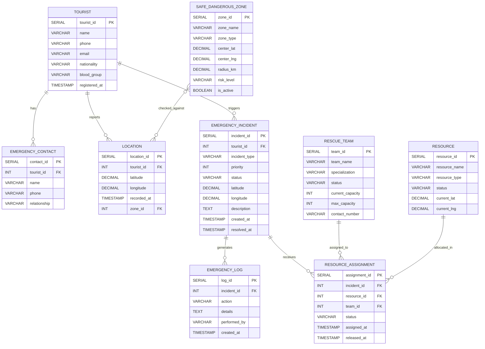

# Smart Tourist Safety and Emergency Response System
## Complete Project Analysis

---

## STEP 1: Requirements Analysis

### Core Problem
Multiple tourist emergencies can occur **simultaneously** while rescue resources (ambulances, rescue teams, helicopters) are **limited**. The system must:

1. **Prioritize** — which emergency gets attention first?
2. **Allocate safely** — does assigning this resource leave the system in a safe state?
3. **Synchronize** — prevent two emergencies from grabbing the same resource
4. **Transact reliably** — never leave a half-completed assignment in the database
5. **Notify in real-time** — push updates to tourists and authority dashboard

### What We're Building

| Component | Technology | Purpose |
|-----------|-----------|---------|
| Mobile App | Flutter/Dart/Android | Tourist registration, SOS, location, alerts |
| Backend | Python/Flask | Business logic, event processing, resource management |
| Database | PostgreSQL/psycopg2 | Persistent storage with ACID guarantees |
| Real-time | Flask-SocketIO | Push notifications to app and dashboard |
| Dashboard | HTML/CSS/JS | Emergency authority monitoring interface |
| Simulation | Python scripts | Generate concurrent emergencies for demo |

### Academic Concepts to Demonstrate

**OS Concepts:**
1. Multithreading — worker threads processing events concurrently
2. Priority Scheduling — PriorityQueue ordering events by urgency
3. Synchronization — Lock/Semaphore preventing race conditions
4. IPC — process-level communication demo (separate from thread queues)
5. Resource Allocation — managing limited rescue resources
6. Deadlock Avoidance — Banker's Algorithm for safe-state verification

**DBMS Concepts:**
1. ER Model & Relational Design — 9 entities with relationships
2. Constraints — PK, FK, NOT NULL, UNIQUE, CHECK
3. Transactions — BEGIN/COMMIT/ROLLBACK
4. ACID Properties — demonstrated through emergency assignment
5. Concurrency Control — MVCC, locking, advisory locks
6. SQL — complex queries, JOINs, aggregations
7. Indexing — performance optimization

---

## STEP 2: Final Architecture

```
┌───────────────────────────────────────────────────────────────────────────┐
│                           CLIENT LAYER                                    │
│                                                                           │
│  ┌──────────────────────┐                  ┌────────────────────────────┐ │
│  │   Flutter Android    │                  │   Authority Dashboard      │ │
│  │   Tourist App        │                  │   (HTML/CSS/JS)            │ │
│  │                      │                  │                            │ │
│  │  • Registration      │                  │  • Overview panel          │ │
│  │  • SOS button        │                  │  • Active emergencies      │ │
│  │  • Location sim      │                  │  • Resource status         │ │
│  │  • Emergency status  │                  │  • Rescue team status      │ │
│  │  • Notifications     │                  │  • Incident logs           │ │
│  │  • Contacts mgmt     │                  │  • Banker's state view     │ │
│  └──────────┬───────────┘                  └──────────────┬─────────────┘ │
│             │                                             │               │
│             │  REST API + Socket.IO                       │  WebSocket    │
└─────────────┼─────────────────────────────────────────────┼───────────────┘
              │                                             │
┌─────────────┼─────────────────────────────────────────────┼───────────────┐
│             ▼              BACKEND LAYER                  ▼               │
│  ┌────────────────────────────────────────────────────────────────────┐   │
│  │                  Python Flask + Flask-SocketIO                      │   │
│  │                                                                    │   │
│  │  ┌──────────────┐     ┌──────────────────────────────────────┐    │   │
│  │  │   REST API   │     │       EVENT PROCESSING ENGINE        │    │   │
│  │  │   Routes     │────▶│                                      │    │   │
│  │  │              │     │  ┌──────────────────────────────┐    │    │   │
│  │  │ /tourists    │     │  │    PriorityQueue             │    │    │   │
│  │  │ /emergencies │     │  │    (Priority Scheduling)     │    │    │   │
│  │  │ /resources   │     │  └──────────────┬───────────────┘    │    │   │
│  │  │ /location    │     │                 │                    │    │   │
│  │  │ /dashboard   │     │  ┌──────────────▼───────────────┐    │    │   │
│  │  └──────────────┘     │  │    Worker Thread Pool        │    │    │   │
│  │                       │  │    (Multithreading)          │    │    │   │
│  │                       │  │                              │    │    │   │
│  │                       │  │  ┌─────────┐ ┌──────────┐   │    │    │   │
│  │                       │  │  │GPS      │ │SOS       │   │    │    │   │
│  │                       │  │  │Worker   │ │Worker    │   │    │    │   │
│  │                       │  │  └─────────┘ └──────────┘   │    │    │   │
│  │                       │  │  ┌─────────┐ ┌──────────┐   │    │    │   │
│  │                       │  │  │Geofence │ │Notif     │   │    │    │   │
│  │                       │  │  │Worker   │ │Worker    │   │    │    │   │
│  │                       │  │  └─────────┘ └──────────┘   │    │    │   │
│  │                       │  └──────────────┬───────────────┘    │    │   │
│  │                       │                 │                    │    │   │
│  │                       │  ┌──────────────▼───────────────┐    │    │   │
│  │                       │  │  Synchronization Manager     │    │    │   │
│  │                       │  │  (Lock / Semaphore)          │    │    │   │
│  │                       │  └──────────────┬───────────────┘    │    │   │
│  │                       │                 │                    │    │   │
│  │                       │  ┌──────────────▼───────────────┐    │    │   │
│  │                       │  │  Resource Manager            │    │    │   │
│  │                       │  │  + Banker's Algorithm        │    │    │   │
│  │                       │  │  (Deadlock Avoidance)        │    │    │   │
│  │                       │  └──────────────┬───────────────┘    │    │   │
│  │                       └─────────────────┼────────────────────┘    │   │
│  │                                         │                        │   │
│  │  ┌──────────────────────────────────────▼─────────────────┐      │   │
│  │  │              Database Layer (psycopg2)                  │      │   │
│  │  │  • ThreadedConnectionPool                               │      │   │
│  │  │  • Parameterized queries                                │      │   │
│  │  │  • Transaction management (BEGIN/COMMIT/ROLLBACK)       │      │   │
│  │  └──────────────────────────────┬─────────────────────────┘      │   │
│  │                                 │                                │   │
│  │  ┌──────────────────────────────▼─────────────────────────┐      │   │
│  │  │           Notification Service (SocketIO)               │      │   │
│  │  │  • Emergency status updates                             │      │   │
│  │  │  • Resource assignment notifications                    │      │   │
│  │  │  • Dashboard live updates                               │      │   │
│  │  └────────────────────────────────────────────────────────┘      │   │
│  └────────────────────────────────────────────────────────────────┘   │
└───────────────────────────────────────────────────────────────────────┘
              │
┌─────────────┼─────────────────────────────────────────────────────────┐
│             ▼                   DATA LAYER                             │
│  ┌──────────────────────────────────────────────────────────────┐     │
│  │                      PostgreSQL                               │     │
│  │                                                               │     │
│  │  TOURIST ──1:N──▶ EMERGENCY_CONTACT                          │     │
│  │  TOURIST ──1:N──▶ LOCATION                                   │     │
│  │  TOURIST ──1:N──▶ EMERGENCY_INCIDENT                         │     │
│  │  EMERGENCY_INCIDENT ──1:N──▶ EMERGENCY_LOG                   │     │
│  │  EMERGENCY_INCIDENT ──1:N──▶ RESOURCE_ASSIGNMENT             │     │
│  │  RESCUE_TEAM ──1:N──▶ RESOURCE_ASSIGNMENT                    │     │
│  │  RESOURCE ──1:N──▶ RESOURCE_ASSIGNMENT                       │     │
│  │  SAFE_DANGEROUS_ZONE (referenced during geofence checks)     │     │
│  │                                                               │     │
│  │  Features: ACID, MVCC, Advisory Locks, Indexes               │     │
│  └──────────────────────────────────────────────────────────────┘     │
└───────────────────────────────────────────────────────────────────────┘
```

### Event Processing Pipeline (detailed)

```
Incoming Request (e.g., POST /api/emergencies/sos)
        │
        ▼
┌───────────────────┐
│  Flask API Route  │  Validate input, create event object
└────────┬──────────┘
         │
         ▼
┌───────────────────┐
│  PriorityQueue    │  Events sorted: 1=Accident > 2=SOS > 3=Zone > 5=GPS
│  (OS: Priority    │  Python queue.PriorityQueue (thread-safe)
│   Scheduling)     │
└────────┬──────────┘
         │
         ▼
┌───────────────────┐
│  Worker Thread    │  Dequeues highest-priority event
│  (OS: Multi-      │  3 worker threads in a pool
│   threading)      │
└────────┬──────────┘
         │
         ▼
┌───────────────────┐
│  Sync Manager     │  threading.Lock protects resource state
│  (OS: Synchro-    │  threading.Semaphore limits concurrent assignments
│   nization)       │
└────────┬──────────┘
         │
         ▼
┌───────────────────┐
│  Resource Manager │  Finds suitable available resource
│  + Banker's Algo  │  Checks: Request ≤ Need? Request ≤ Available?
│  (OS: Deadlock    │  Runs Safety Algorithm
│   Avoidance)      │  If SAFE → grant; If UNSAFE → deny/wait
└────────┬──────────┘
         │
         ▼
┌───────────────────┐
│  DB Transaction   │  BEGIN → INSERT incident → UPDATE resource →
│  (DBMS: ACID,     │  INSERT assignment → INSERT log → COMMIT
│   Transactions)   │  On failure → ROLLBACK
└────────┬──────────┘
         │
         ▼
┌───────────────────┐
│  Notification     │  SocketIO emit to tourist app room
│  Service          │  SocketIO emit to dashboard room
└───────────────────┘
```

---

## STEP 3: Database ER Model and Relationships

### Entity-Relationship Diagram



### Entity Explanations

#### 1. TOURIST
- **Purpose:** Stores registered tourist information
- **Design decisions:**
  - `phone` is UNIQUE — each tourist has a unique phone number (primary contact method)
  - `email` is UNIQUE — prevents duplicate registrations
  - `blood_group` included for medical emergencies
  - `nationality` useful for authority coordination

#### 2. EMERGENCY_CONTACT
- **Purpose:** Emergency contacts for each tourist (family, embassy, etc.)
- **Relationship:** Many contacts per tourist (1:N)
- **Design:** FK to TOURIST with CASCADE delete — if tourist is removed, contacts go too

#### 3. LOCATION
- **Purpose:** Track tourist location history (simulated GPS updates)
- **Relationship:** Many locations per tourist (1:N)
- **Design:**
  - `zone_id` is nullable FK — location may or may not fall within a known zone
  - Timestamps allow location history queries

#### 4. EMERGENCY_INCIDENT
- **Purpose:** Central record of every emergency event
- **Relationship:** Belongs to a tourist (N:1), has many logs (1:N), has many assignments (1:N)
- **Design:**
  - `incident_type` CHECK constraint limits to: 'CRITICAL_ACCIDENT', 'SOS', 'DANGEROUS_ZONE', 'SAFETY_ALERT', 'GPS_UPDATE'
  - `priority` CHECK constraint: 1-5
  - `status` tracks lifecycle: 'RECEIVED', 'QUEUED', 'PROCESSING', 'RESOURCE_ASSIGNED', 'RESOLVED', 'FAILED'
  - `resolved_at` is nullable (set when resolved)

#### 5. SAFE_DANGEROUS_ZONE
- **Purpose:** Predefined geographic zones classified as safe or dangerous
- **Design:**
  - `zone_type` CHECK: 'SAFE' or 'DANGEROUS'
  - `risk_level` CHECK: 'LOW', 'MEDIUM', 'HIGH', 'CRITICAL'
  - `radius_km` defines the zone boundary (circular geofence)
  - `is_active` allows enabling/disabling zones
  - Used during geofence processing to determine if a tourist is in danger

#### 6. EMERGENCY_LOG
- **Purpose:** Audit trail for every action taken on an incident
- **Relationship:** Many logs per incident (1:N)
- **Design:**
  - `action` examples: 'INCIDENT_CREATED', 'RESOURCE_REQUESTED', 'RESOURCE_ASSIGNED', 'BANKER_CHECK_SAFE', 'BANKER_CHECK_UNSAFE', 'TRANSACTION_COMMITTED', 'TRANSACTION_ROLLED_BACK'
  - `performed_by` identifies the system component (e.g., 'RESOURCE_MANAGER', 'WORKER_THREAD_1')
  - Critical for demonstrating the system pipeline during the final demo

#### 7. RESCUE_TEAM
- **Purpose:** Emergency response teams that can be dispatched
- **Design:**
  - `specialization` CHECK: 'MEDICAL', 'SEARCH_AND_RESCUE', 'FIRE', 'GENERAL'
  - `status` CHECK: 'AVAILABLE', 'BUSY', 'OFF_DUTY'
  - `current_capacity` / `max_capacity` — supports Banker's Algorithm modeling

#### 8. RESOURCE
- **Purpose:** Physical resources (ambulances, helicopters, etc.)
- **Design:**
  - `resource_type` CHECK: 'AMBULANCE', 'HELICOPTER', 'FIRE_TRUCK', 'RESCUE_BOAT'
  - `status` CHECK: 'AVAILABLE', 'ASSIGNED', 'MAINTENANCE', 'OUT_OF_SERVICE'
  - Location tracking for resource proximity queries

#### 9. RESOURCE_ASSIGNMENT
- **Purpose:** Junction table recording which resources/teams are assigned to which incidents
- **Relationship:** Links EMERGENCY_INCIDENT, RESOURCE, and RESCUE_TEAM
- **Design:**
  - `resource_id` and `team_id` are both nullable — an incident might get a resource without a team or vice versa
  - `status` CHECK: 'ASSIGNED', 'EN_ROUTE', 'ON_SITE', 'COMPLETED', 'CANCELLED'
  - `released_at` is nullable (set when resource is freed)
  - UNIQUE constraint on `(resource_id, incident_id)` prevents duplicate assignments

### Cardinality Summary

| Relationship | Cardinality | FK Location |
|---|---|---|
| TOURIST → EMERGENCY_CONTACT | 1:N | EMERGENCY_CONTACT.tourist_id |
| TOURIST → LOCATION | 1:N | LOCATION.tourist_id |
| TOURIST → EMERGENCY_INCIDENT | 1:N | EMERGENCY_INCIDENT.tourist_id |
| EMERGENCY_INCIDENT → EMERGENCY_LOG | 1:N | EMERGENCY_LOG.incident_id |
| EMERGENCY_INCIDENT → RESOURCE_ASSIGNMENT | 1:N | RESOURCE_ASSIGNMENT.incident_id |
| RESCUE_TEAM → RESOURCE_ASSIGNMENT | 1:N | RESOURCE_ASSIGNMENT.team_id |
| RESOURCE → RESOURCE_ASSIGNMENT | 1:N | RESOURCE_ASSIGNMENT.resource_id |
| SAFE_DANGEROUS_ZONE → LOCATION | 1:N (optional) | LOCATION.zone_id |

### Key Indexes

| Table | Index | Purpose |
|---|---|---|
| EMERGENCY_INCIDENT | `idx_incident_status` on (status) | Fast lookup of active incidents |
| EMERGENCY_INCIDENT | `idx_incident_priority` on (priority) | Priority-based queries |
| EMERGENCY_INCIDENT | `idx_incident_tourist` on (tourist_id) | Tourist's incident history |
| LOCATION | `idx_location_tourist` on (tourist_id) | Latest location lookup |
| LOCATION | `idx_location_time` on (recorded_at) | Time-based queries |
| RESOURCE | `idx_resource_status` on (status) | Available resource lookup |
| RESOURCE_ASSIGNMENT | `idx_assignment_incident` on (incident_id) | Incident's assignments |
| RESCUE_TEAM | `idx_team_status` on (status) | Available team lookup |

### Normalization
- All tables are in **3NF** (Third Normal Form)
- No repeating groups, no partial dependencies, no transitive dependencies
- RESOURCE_ASSIGNMENT is a proper junction table resolving M:N relationships

---

## STEP 4: Backend Architecture

### Module Responsibilities

```
backend/
│
├── app.py                          ← Flask app factory, SocketIO init, startup
├── config.py                       ← Loads .env, exposes config constants
├── requirements.txt                ← Python dependencies
│
├── api/                            ← REST API layer (HTTP request/response)
│   ├── __init__.py                 ← Blueprint registration
│   ├── tourist_routes.py           ← POST/GET/PUT tourists
│   ├── location_routes.py          ← POST locations, GET tourist locations
│   ├── emergency_routes.py         ← POST SOS/accident/geofence/alert
│   ├── resource_routes.py          ← GET resources, GET teams
│   └── dashboard_routes.py         ← GET summary, active emergencies, logs
│
├── workers/                        ← OS: Multithreading
│   ├── __init__.py
│   ├── worker_manager.py           ← Creates and manages worker thread pool
│   ├── gps_worker.py               ← Processes GPS update events
│   ├── sos_worker.py               ← Processes SOS events
│   ├── geofence_worker.py          ← Processes dangerous-zone events
│   └── notification_worker.py      ← Processes notification dispatch
│
├── scheduler/                      ← OS: Priority Scheduling
│   ├── __init__.py
│   └── priority_queue.py           ← PriorityQueue wrapper, event model
│
├── resource_manager/               ← OS: Resource Allocation + Deadlock Avoidance
│   ├── __init__.py
│   ├── resource_manager.py         ← Resource request/release logic
│   ├── bankers_algorithm.py        ← Available, Max, Allocation, Need, Safety Check
│   └── synchronization.py          ← Lock, Semaphore, shared state protection
│
├── notifications/                  ← Real-time communication
│   ├── __init__.py
│   └── socket_service.py           ← SocketIO event emission
│
├── db/                             ← DBMS: Database layer
│   ├── __init__.py
│   ├── connection.py               ← ThreadedConnectionPool, get/release conn
│   ├── repositories.py             ← Parameterized SQL queries per entity
│   └── transactions.py             ← Transaction wrapper (BEGIN/COMMIT/ROLLBACK)
│
└── utils/                          ← Shared utilities
    ├── __init__.py
    ├── validators.py               ← Input validation helpers
    └── logger.py                   ← Logging configuration
```

### Key Design Principles

1. **API layer** only handles HTTP — validation, serialization, routing
2. **Workers** contain business logic for each event type
3. **Scheduler** is the single entry point for all events into the processing pipeline
4. **Resource Manager** is the gatekeeper — nothing gets assigned without passing through it
5. **DB layer** is the only code that touches PostgreSQL — no SQL in routes or workers
6. **Notifications** are decoupled — workers call the notification service, they don't emit directly

### REST API Design

#### Tourist APIs

| Method | Endpoint | Purpose | Status Codes |
|--------|----------|---------|-------------|
| POST | `/api/tourists` | Register new tourist | 201, 400, 409 |
| GET | `/api/tourists` | List all tourists | 200 |
| GET | `/api/tourists/<id>` | Get tourist by ID | 200, 404 |
| PUT | `/api/tourists/<id>` | Update tourist info | 200, 400, 404 |

#### Emergency Contact APIs

| Method | Endpoint | Purpose | Status Codes |
|--------|----------|---------|-------------|
| POST | `/api/tourists/<id>/contacts` | Add emergency contact | 201, 400, 404 |
| GET | `/api/tourists/<id>/contacts` | List tourist's contacts | 200, 404 |

#### Location APIs

| Method | Endpoint | Purpose | Status Codes |
|--------|----------|---------|-------------|
| POST | `/api/location` | Submit location update | 201, 400 |
| GET | `/api/tourists/<id>/locations` | Get tourist's location history | 200, 404 |

#### Emergency APIs

| Method | Endpoint | Purpose | Status Codes |
|--------|----------|---------|-------------|
| POST | `/api/emergencies/sos` | Trigger SOS | 201, 400 |
| POST | `/api/emergencies/accident` | Report critical accident | 201, 400 |
| POST | `/api/emergencies/geofence` | Report dangerous-zone entry | 201, 400 |
| POST | `/api/emergencies/safety-alert` | General safety alert | 201, 400 |
| GET | `/api/emergencies` | List all incidents | 200 |
| GET | `/api/emergencies/<id>` | Get incident details | 200, 404 |

#### Resource APIs

| Method | Endpoint | Purpose | Status Codes |
|--------|----------|---------|-------------|
| GET | `/api/resources` | List all resources | 200 |
| GET | `/api/resources/available` | List available resources | 200 |
| GET | `/api/rescue-teams` | List all rescue teams | 200 |
| GET | `/api/rescue-teams/available` | List available teams | 200 |

#### Dashboard APIs

| Method | Endpoint | Purpose | Status Codes |
|--------|----------|---------|-------------|
| GET | `/api/dashboard/summary` | Stats overview | 200 |
| GET | `/api/dashboard/active-emergencies` | Active incident list | 200 |
| GET | `/api/dashboard/logs` | Emergency log history | 200 |
| GET | `/api/dashboard/banker-state` | Current Banker's Algorithm state | 200 |

---

## STEP 5: Flutter Architecture / Screens

### Screen Map

```
┌─────────────────────────────────────────────┐
│                SPLASH SCREEN                 │
│          App logo + loading                  │
└──────────────────┬──────────────────────────┘
                   │
          ┌────────▼────────┐
          │  REGISTRATION   │  (if no saved tourist)
          │  Name, Phone,   │
          │  Email, Blood   │
          │  Group, Nation. │
          └────────┬────────┘
                   │
          ┌────────▼────────┐
          │   TOURIST HOME  │  ◄── Main screen
          │                 │
          │  ┌───────────┐  │
          │  │ SOS BTN   │  │  (prominent red button)
          │  └───────────┘  │
          │                 │
          │  Safety Status  │
          │  Last Location  │
          │  Active Alerts  │
          └───┬──┬──┬──┬───┘
              │  │  │  │
     ┌────────┘  │  │  └──────────┐
     ▼           ▼  ▼             ▼
┌─────────┐ ┌──────┐ ┌────────┐ ┌──────────────┐
│ Profile │ │Emerg.│ │Contacts│ │ Notifications│
│         │ │Status│ │  Mgmt  │ │              │
└─────────┘ └──────┘ └────────┘ └──────────────┘
```

### Screen Details

| # | Screen | Purpose | Key Widgets |
|---|--------|---------|-------------|
| 1 | **Splash** | Loading, app branding | Logo, progress indicator |
| 2 | **Registration** | Tourist sign-up | Form fields, validation, submit |
| 3 | **Home** | Central hub | SOS button, status card, location card, nav |
| 4 | **Profile** | View/edit tourist info | Display fields, edit button |
| 5 | **Emergency Contacts** | Manage contacts | List, add/delete, form |
| 6 | **SOS** | Emergency trigger | Confirm dialog, location capture, status |
| 7 | **Emergency Status** | Track active emergency | Status timeline, assigned resources |
| 8 | **Notifications** | Alert history | List of received notifications |

### Flutter Project Structure

```
mobile/tourist_app/lib/
│
├── main.dart                      ← App entry, routes
│
├── config/
│   └── api_config.dart            ← Backend URL, endpoints
│
├── models/
│   ├── tourist.dart               ← Tourist data model
│   ├── emergency_contact.dart     ← Contact model
│   ├── location.dart              ← Location model
│   ├── emergency.dart             ← Emergency incident model
│   └── notification.dart          ← Notification model
│
├── services/
│   ├── api_service.dart           ← HTTP client (REST calls)
│   ├── socket_service.dart        ← Socket.IO client
│   └── location_service.dart      ← Simulated GPS service
│
├── screens/
│   ├── splash_screen.dart
│   ├── registration_screen.dart
│   ├── home_screen.dart
│   ├── profile_screen.dart
│   ├── contacts_screen.dart
│   ├── sos_screen.dart
│   ├── emergency_status_screen.dart
│   └── notifications_screen.dart
│
└── widgets/
    ├── sos_button.dart            ← Reusable SOS button
    ├── status_card.dart           ← Emergency status display
    └── location_card.dart         ← Location display
```

### Key Flutter Packages

| Package | Purpose |
|---------|---------|
| `http` | REST API calls to Flask |
| `socket_io_client` | Socket.IO connection for real-time updates |
| `provider` | State management |
| `shared_preferences` | Store tourist_id locally after registration |

---

## STEP 6: Dashboard Architecture

### Page Layout

```
┌────────────────────────────────────────────────────────────────────┐
│  EMERGENCY AUTHORITY DASHBOARD                    [●] Connected    │
├──────────┬─────────────────────────────────────────────────────────┤
│          │                                                         │
│  NAV     │   ┌──────────┐ ┌──────────┐ ┌──────────┐ ┌──────────┐│
│          │   │ Active   │ │ Critical │ │ Resources│ │ Teams    ││
│ Overview │   │ Incidents│ │ Count    │ │ Available│ │ Available││
│          │   │   12     │ │    3     │ │   5/8    │ │   3/5   ││
│ Active   │   └──────────┘ └──────────┘ └──────────┘ └──────────┘│
│ Emerg.   │                                                        │
│          │   ┌────────────────────────────────────────────────────┐│
│ Resources│   │  ACTIVE EMERGENCIES                                ││
│          │   │                                                    ││
│ Teams    │   │  ID │ Tourist │ Type     │ Priority │ Status      ││
│          │   │  47 │ Alice   │ ACCIDENT │ 1        │ PROCESSING  ││
│ Logs     │   │  46 │ Bob     │ SOS      │ 2        │ QUEUED      ││
│          │   │  45 │ Carol   │ ZONE     │ 3        │ ASSIGNED    ││
│ Banker   │   └────────────────────────────────────────────────────┘│
│ State    │                                                        │
│          │   ┌────────────────────────────────────────────────────┐│
│          │   │  RESOURCE STATUS                                   ││
│          │   │                                                    ││
│          │   │  Ambulance-01   [ASSIGNED] → Incident #47         ││
│          │   │  Ambulance-02   [AVAILABLE]                        ││
│          │   │  Helicopter-01  [AVAILABLE]                        ││
│          │   └────────────────────────────────────────────────────┘│
│          │                                                        │
│          │   ┌────────────────────────────────────────────────────┐│
│          │   │  BANKER'S ALGORITHM STATE                          ││
│          │   │                                                    ││
│          │   │  Available: [1, 1, 0]                              ││
│          │   │  Max:      [[2,1,1],[1,2,1],[1,1,1]]              ││
│          │   │  Alloc:    [[1,0,1],[0,1,0],[0,0,1]]              ││
│          │   │  Need:     [[1,1,0],[1,1,1],[1,1,0]]              ││
│          │   │  System State: SAFE ✓                              ││
│          │   └────────────────────────────────────────────────────┘│
└──────────┴─────────────────────────────────────────────────────────┘
```

### Dashboard Files

```
dashboard/
│
├── index.html       ← Single-page layout with sections
├── style.css        ← Styling (dark theme, status colors)
└── app.js           ← Fetch API calls + Socket.IO for live updates
```

### Key Dashboard Features

1. **Auto-refresh** — periodic polling OR WebSocket-driven updates
2. **Color-coded priorities** — Red (Critical), Orange (SOS), Yellow (Zone), Blue (Alert), Green (GPS)
3. **Banker's state panel** — shows Available, Max, Allocation, Need matrices live
4. **Log stream** — scrollable list of recent emergency log entries
5. **Connection indicator** — shows WebSocket connection status

---

## STEP 7: Complete Development Roadmap

| Phase | Name | Deliverables | Estimated Effort | OS | DBMS |
|-------|------|-------------|------------------|-----|------|
| **0** | Environment Verification | All tools checked & confirmed | 30 min | — | — |
| **1** | Project Initialization | Folder structure, .env, .gitignore, requirements.txt, git init | 30 min | — | — |
| **2** | Database Design | ER diagram, documented schema, reviewed relationships | 45 min | — | ✓ |
| **3** | PostgreSQL Schema | schema.sql with all 9 tables, constraints, indexes | 45 min | — | ✓ |
| **4** | Seed Data | seed.sql with realistic sample data | 30 min | — | ✓ |
| **5** | Database Connection Layer | connection.py with ThreadedConnectionPool | 30 min | — | ✓ |
| **6** | Flask Backend Foundation | app.py, config.py, blueprint registration | 30 min | — | — |
| **7** | Tourist APIs | CRUD endpoints, validation, tests | 45 min | — | ✓ |
| **8** | Location APIs | Location POST/GET, zone check | 30 min | — | ✓ |
| **9** | Emergency APIs | SOS, accident, geofence, alert endpoints | 45 min | — | ✓ |
| **10** | Priority Queue | PriorityQueue wrapper, event model, priority demo | 45 min | ✓ | — |
| **11** | Worker Threads | Worker pool, GPS/SOS/geofence workers | 1 hr | ✓ | — |
| **12** | Synchronization | Lock, Semaphore, contention demo | 45 min | ✓ | — |
| **13** | Resource Manager | Request/release, availability tracking | 45 min | ✓ | — |
| **14** | Banker's Algorithm | Full implementation with safe/unsafe tests | 1 hr | ✓ | — |
| **15** | Transactions & Concurrency | Full assignment workflow, ROLLBACK demo | 1 hr | — | ✓ |
| **16** | Simulation Engine | event_generator.py, concurrent events | 45 min | ✓ | ✓ |
| **17** | REST API Testing | All endpoint tests | 45 min | — | ✓ |
| **18** | WebSocket Notifications | Socket.IO integration | 45 min | ✓ | — |
| **19** | Authority Dashboard | HTML/CSS/JS dashboard | 1.5 hr | — | ✓ |
| **20** | Flutter Application | All screens, widgets | 2 hr | — | — |
| **21** | Flutter-Backend Integration | API + Socket.IO connection | 1 hr | — | — |
| **22** | End-to-End Testing | Full pipeline verification | 1 hr | ✓ | ✓ |
| **23** | Final Demonstration | Demo scenario script | 45 min | ✓ | ✓ |
| **24** | Documentation | All docs, README, OS/DBMS explanations | 1.5 hr | ✓ | ✓ |
| **25** | Report & Presentation Prep | Final report, slides outline | 1 hr | ✓ | ✓ |

### Dependency Graph

```
Phase 0 → Phase 1 → Phase 2 → Phase 3 → Phase 4
                                   ↓
                              Phase 5 → Phase 6
                                           ↓
                              Phase 7 → Phase 8 → Phase 9
                                                      ↓
                              Phase 10 → Phase 11 → Phase 12
                                                       ↓
                              Phase 13 → Phase 14 → Phase 15
                                                       ↓
                              Phase 16 → Phase 17 → Phase 18
                                                       ↓
                                                  Phase 19
                                                       ↓
                              Phase 20 → Phase 21 → Phase 22
                                                       ↓
                              Phase 23 → Phase 24 → Phase 25
```

---

## STEP 8: Technical Risks & Mitigations

| # | Risk | Impact | Mitigation |
|---|------|--------|------------|
| 1 | **Banker's Algorithm mapping to dynamic system** — classical Banker's has fixed processes; our emergencies are dynamic | Could make Banker's feel artificial | Model 3 resource *types* (ambulances, rescue teams, helicopters) as Banker's resource classes. Active emergencies with pending resource needs become "processes." Each emergency type has a predefined max resource need based on severity. |
| 2 | **IPC vs. inter-thread confusion** — Python `queue.Queue` is inter-thread, not true OS IPC | Could lose marks if examiner asks about IPC | Build core pipeline with threads (practical). Add a **separate IPC demo** using `multiprocessing.Queue` or `multiprocessing.Pipe` with clear documentation distinguishing the two. |
| 3 | **Python GIL and true parallelism** — Python's GIL means threads don't run truly in parallel for CPU-bound work | Examiner might question threading | Our work is I/O-bound (DB queries, network). Threading is appropriate and effective. Document this distinction. For the IPC demo, `multiprocessing` shows true parallelism. |
| 4 | **Flask-SocketIO + threading compatibility** — need compatible async mode | Server might hang or miss events | Use `eventlet` or `threading` mode for Flask-SocketIO. Test early in Phase 18. |
| 5 | **Flutter Socket.IO client compatibility** — must match server protocol version | Real-time updates might not work on mobile | Use `socket_io_client` Dart package (v4). Verify protocol version match during Phase 21. |
| 6 | **System resource pressure** — PostgreSQL + Flask + Android Emulator on one machine | Slowness, crashes | Test backend fully before starting Flutter. Can use physical Android device. |
| 7 | **PostgreSQL not installed or configured** — student environment might not have it | Blocks Phase 3 onwards | Phase 0 verifies this. Provide exact install instructions for Ubuntu. |
| 8 | **Advisory lock misuse** — if used incorrectly can cause hangs | Backend freeze | Use advisory locks only for resource assignment with timeouts. Document clearly. |

### Ambiguities Noted

1. **No proposal PDF received** — using the detailed prompt as specification. If the PDF differs, we'll reconcile.
2. **Authentication** — the prompt mentions "Login if authentication is implemented." I'll implement a **simple tourist ID-based identification** (not full JWT auth) unless you request otherwise. This keeps focus on OS/DBMS concepts.
3. **Map display** — simulated coordinates, no Google Maps API key required. A simple text/coordinate display will suffice.

---

## STEP 9: Initial PROJECT_STATE

See the file created at: `docs/PROJECT_STATE.md` (will be created in Phase 1 in the actual project directory)

```
============================================================
PROJECT STATE
============================================================

Project:
Smart Tourist Safety and Emergency Response System

Current Phase:
PRE-PHASE — Analysis Complete, Awaiting START PHASE 0

Current Task:
Waiting for user approval to begin Phase 0

Last Completed Phase:
N/A (project not yet started)

Completed:
- Requirements analysis
- Architecture design (Step 2)
- Database ER model and relationships (Step 3)
- Backend architecture design (Step 4)
- Flutter architecture / screens (Step 5)
- Dashboard architecture (Step 6)
- Development roadmap (Step 7)
- Technical risks identified (Step 8)
- Initial PROJECT_STATE created (Step 9)

Files Created:
- (none — project directory not yet initialized)

Files Modified:
- (none)

Database:
- PostgreSQL installed: UNKNOWN (Phase 0)
- Database created: NO
- Schema complete: NO
- Seed data complete: NO

Backend:
- Flask: NO
- APIs completed: none
- Workers completed: none
- Priority Queue: NO
- Synchronization: NO
- Resource Manager: NO
- Banker's Algorithm: NO

Flutter:
- Project created: NO
- Screens completed: none
- API integration: NO
- WebSocket integration: NO

Dashboard:
- Created: NO
- API connected: NO
- Real-time updates: NO

OS Concepts Completed:
- Multithreading: NO
- Priority Scheduling: NO
- Synchronization: NO
- IPC: NO
- Resource Allocation: NO
- Banker's Algorithm: NO

DBMS Concepts Completed:
- ER Model: DESIGNED (not implemented)
- Tables: NO
- Constraints: NO
- Transactions: NO
- ACID: NO
- Concurrency: NO
- MVCC: NO
- Locking: NO

Tests Passed:
- (none)

Tests Failed:
- (none)

Known Bugs:
- (none)

Known Design Decisions:
- Priority: lower number = higher priority (1=Critical, 5=GPS)
- Worker thread pool size = 3
- Banker's Algorithm models 3 resource types as resource classes
- IPC demonstrated separately from inter-thread communication
- Simple tourist-ID identification (no full JWT auth)
- GPS coordinates simulated
- eventlet or threading mode for Flask-SocketIO
- socket_io_client Dart package for Flutter real-time

Next Exact Step:
User says "START PHASE 0" → verify Python, PostgreSQL, Flutter,
Android Studio, Git, and required tooling

============================================================
```
